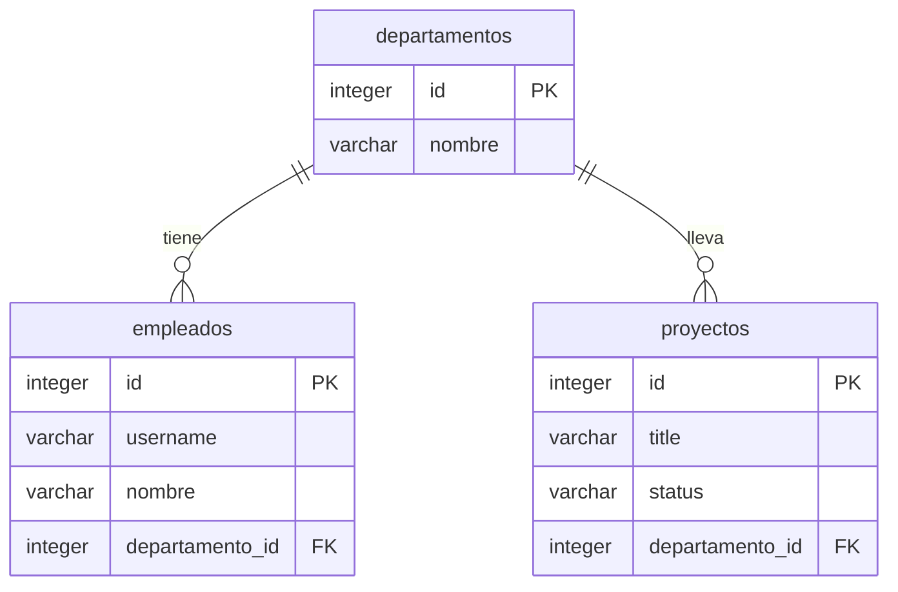
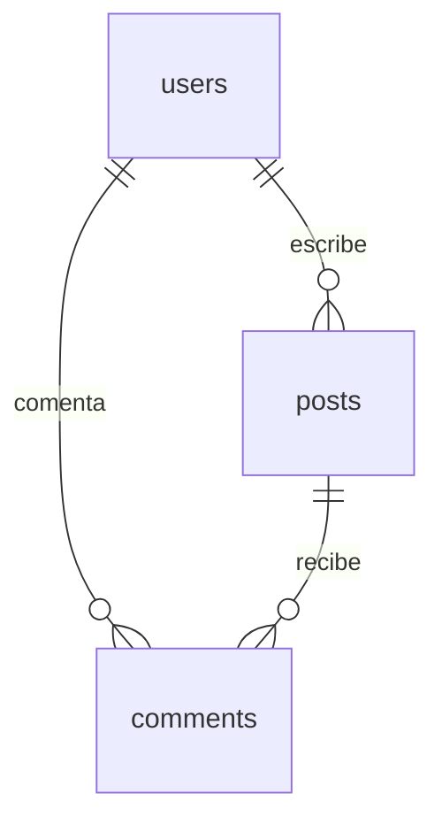

# Clase SQL 2 · Relaciones entre tablas, diagramas y JOIN

En SQL 1 se trabajó con una única tabla (`peliculas`). En esta clase se da el salto a **varias tablas relacionadas entre sí**: cómo se conectan (primary key y foreign key), qué tipos de relación existen, cómo diseñarlas y dibujarlas (dbdiagram.io), cómo crearlas en PostgreSQL con `REFERENCES` y cómo combinarlas en una consulta con `JOIN`.

El entorno es el mismo que en SQL 1: **PostgreSQL + pgAdmin** con Docker Compose (ver [clase-docker3](../../docker/clase-docker3/README.md)).

## Objetivos de la sesión

1. Entender cómo se relacionan las tablas: primary key y foreign key.
2. Distinguir relaciones uno a uno, uno a muchos y muchos a muchos.
3. Dibujar el diagrama de una base de datos.
4. Crear tablas relacionadas con `REFERENCES`.
5. Combinar varias tablas en una consulta con `INNER`, `LEFT`, `RIGHT` y `FULL OUTER JOIN`, y saber cuándo usar cada uno.

## Índice

1. [Calentamiento: repaso de SQL 1](#1-calentamiento-repaso-de-sql-1)
2. [Relaciones: primary key y foreign key](#2-relaciones-primary-key-y-foreign-key)
3. [Tipos de relación](#3-tipos-de-relación)
4. [Ponte a prueba: identificar relaciones](#4-ponte-a-prueba-identificar-relaciones)
5. [Diseñar la base de datos: los cuatro pasos](#5-diseñar-la-base-de-datos-los-cuatro-pasos)
6. [Dibujar el diagrama con dbdiagram.io](#6-dibujar-el-diagrama-con-dbdiagramio)
7. [Práctica 1: empleados, departamentos y proyectos](#7-práctica-1-empleados-departamentos-y-proyectos)
8. [Tablas relacionadas en SQL: `REFERENCES`](#8-tablas-relacionadas-en-sql-references)
9. [SQL JOIN](#9-sql-join)
10. [Práctica 2: crear las tablas y cargar los datos](#10-práctica-2-crear-las-tablas-y-cargar-los-datos)
11. [Extras: comparar JOIN y agregaciones](#11-extras-comparar-join-y-agregaciones)
12. [Repaso final](#12-repaso-final)
13. [Resumen de sintaxis](#13-resumen-de-sintaxis)

---

## 1. Calentamiento: repaso de SQL 1

| Pregunta | Respuesta | Por qué |
|---|---|---|
| Quedarte con la tabla y sus columnas, pero sin filas | `TRUNCATE TABLE estudiantes;` | `DROP` borra la tabla entera; `TRUNCATE` vacía las filas y conserva la estructura |
| Nombres que empiezan por «Ma» | `WHERE nombre LIKE 'Ma%'` | `%` al final = cualquier cosa después de «Ma» |
| Quedarte solo con los grupos de más de 10 filas (`COUNT(*) > 10`) | En el `HAVING` | `WHERE` filtra filas antes de agrupar; `HAVING` filtra grupos ya agrupados |

## 2. Relaciones: primary key y foreign key

En una red social no se ven los usuarios solos ni las publicaciones solas: una publicación se muestra con el nombre de quien la escribió, y el perfil de un usuario muestra sus publicaciones. **Los datos de una tabla están relacionados con los de otra.**

Dos piezas hacen posible esa relación:

| Pieza | Qué es |
|---|---|
| **PK** · Primary key (clave primaria) | Identifica de forma única cada fila de su tabla. Es el `id` que ya se usó en SQL 1 |
| **FK** · Foreign key (clave foránea) | Columna que guarda la **primary key de una fila de otra tabla**; así queda apuntado con quién se relaciona |

> Una foreign key **no** guarda una copia de los datos de la otra tabla, solo su `id`.

## 3. Tipos de relación

### Uno a uno (1:1)

Un estudiante solo puede tener un carnet de universidad y un carnet solo pertenece a un estudiante.

- La foreign key se pone en la tabla que **podría llegar a ser el «muchos»**.
- Aquí, en `carnets`: caducan, así que un estudiante puede acabar teniendo otro nuevo.

### Uno a muchos (1:N)

Un usuario puede tener muchas publicaciones, pero cada publicación es de un único usuario.

- El «muchos» son las publicaciones.
- **La foreign key va en la tabla del «muchos»**: en `publicaciones`.

### Muchos a muchos (N:M)

Un pedido tiene muchos productos y un producto puede estar en muchos pedidos.

- Se crea una **tabla intermedia** y en ella se guardan las **dos foreign keys**.

| Relación | ¿Dónde va la foreign key? |
|---|---|
| 1:1 | En la tabla que podría llegar a ser el «muchos» |
| 1:N | En la tabla del «muchos» |
| N:M | En una tabla intermedia, con las dos FK |

## 4. Ponte a prueba: identificar relaciones

| Caso | Relación | Dónde va la FK |
|---|---|---|
| Cada Pokémon es de un solo tipo; de cada tipo hay muchos Pokémon | **1:N** (tipo → Pokémon) | En `pokemon` (`tipo_id`) |
| Un Pokémon puede tener varios tipos y de cada tipo hay muchos Pokémon | **N:M** | Tabla intermedia `pokemon_tipo` |
| Darth Vader tiene muchos soldados; cada soldado tiene un solo Darth Vader | **1:N** | En la tabla de **soldados** |
| Cada persona pertenece a una única raza; de cada raza hay muchas personas (El Señor de los Anillos) | **1:N** | En `personas` (`raza_id`) |
| Una persona puede pertenecer a varias razas (un medio elfo es humano y elfo) | **N:M** | Tabla intermedia con las dos FK |
| Cada jugador de LoL elige un personaje y cada personaje solo lo elige un jugador | **1:1** | En una de las dos (la que podría ser el «muchos») |

Idea clave: **una misma pareja de entidades cambia de tipo de relación según las reglas del negocio** (un Pokémon con un tipo → 1:N; con varios → N:M).

## 5. Diseñar la base de datos: los cuatro pasos

Para cada caso:

1. ¿Qué **tablas** hay?
2. ¿Qué **campos** tiene cada una? No olvidar su primary key.
3. ¿Qué **tipo de relación** hay entre ellas?
4. ¿Dónde va la **foreign key**? ¿Hace falta una tabla intermedia?

### Casos propuestos para diseñar

| Caso | Pista de relaciones |
|---|---|
| **Director – película**: cada película tiene un director; un director puede dirigir varias. Películas: título, fecha de estreno, género. Director: nombre y DNI | 1:N, FK `director_id` en `peliculas` |
| **TikTok**: un usuario sube varios vídeos; cada vídeo es de un usuario. Usuarios: nombre, nombre de usuario, nº de seguidores. Vídeos: título, fecha de publicación, nº de likes | 1:N, FK `usuario_id` en `videos` |
| **Marvel**: un superhéroe aparece en varias películas y cada película tiene varios superhéroes. Superhéroes: nombre real, alias, poder principal. Películas: título, año, recaudación | N:M, tabla intermedia `superheroe_pelicula` |
| **Club – jugador**: un club tiene varios jugadores; cada jugador juega en un club. Clubes: nombre, ciudad, año de fundación. Jugadores: nombre, dorsal, posición, fecha de alta | 1:N, FK `club_id` en `jugadores` |
| **Netflix**: una serie tiene varias temporadas (cada temporada, una serie); una serie tiene varios géneros y un género aplica a varias series | Series–temporadas 1:N; series–géneros N:M (`serie_genero`) |
| **Clínica veterinaria**: a un veterinario se le asigna una mascota; la mascota tiene un dueño al que hay que avisar | Veterinario–mascota y dueño–mascota; la FK va en `mascotas` |
| **Spotify**: usuarios crean listas con canciones; cada canción es de un artista; una canción tiene varios géneros | Artista–canción 1:N; canción–género N:M; lista–canción N:M; usuario–lista 1:N |

### Extras

- **Librería online**: libros que pertenecen a un departamento; los clientes meten libros en una cesta que, al finalizar la compra, se convierte en un pedido.
- **Instituto**: profesores (DNI, nombre, dirección, teléfono), alumnos (nº de expediente, nombre, apellidos, fecha de nacimiento) y módulos (código, nombre). Un profesor imparte varios módulos pero un módulo solo lo imparte un profesor; un alumno cursa uno o varios módulos; cada curso tiene un grupo de alumnos y uno de ellos es el delegado.

## 6. Dibujar el diagrama con dbdiagram.io

[dbdiagram.io](https://dbdiagram.io) es una web gratuita para dibujar el diagrama de una base de datos **escribiendo texto** (lenguaje DBML).

| Elemento | Significado |
|---|---|
| `Table nombre { ... }` | Una tabla, con sus campos y sus tipos |
| `[primary key]` / `[pk]` | Marca la primary key |
| `Ref: a.col > b.col` | Relación. `>` apunta del «muchos» al «uno» |
| `Ref: a.col - b.col` | Relación uno a uno |
| `Ref: a.col < b.col` | Relación uno a muchos (el «uno» a la izquierda) |
| `[unique]`, `[not null]` | Restricciones de un campo |

Ejemplo de la presentación (usuarios y publicaciones):

```dbml
Table users {
  id integer [primary key]
  first_name varchar
}
Table posts {
  id integer [primary key]
  user_id integer
  title varchar
}
Ref: posts.user_id > users.id
```

## 7. Práctica 1: empleados, departamentos y proyectos

Enunciado:

1. Entrar en dbdiagram.io y crear un diagrama nuevo.
2. Crear las tablas `departamentos`, `empleados` y `proyectos` con sus campos y tipos.
3. Un departamento tiene muchos empleados; un empleado está en un departamento **o en ninguno**.
4. Un departamento lleva muchos proyectos; cada proyecto es de un único departamento.
5. Marcar las primary keys y unir cada foreign key con un `Ref`.

Diagrama resultante en clase:

```dbml
Table departamentos {
  id integer [not null, pk]
  nombre varchar [not null]
}

Table empleados {
  id integer [pk]
  username varchar
  nombre varchar
  departamento_id integer
}

Table proyectos {
  id integer [pk]
  title varchar
  status varchar
  departamento_id integer
}

Ref: departamentos.id < empleados.departamento_id

Ref: departamentos.id < proyectos.departamento_id
```

Y los datos de ejemplo cargados con `Records` (la sección que permite precargar filas en el diagrama):

```dbml
Records departamentos (id, nombre) {
  1, 'Informatica'
  2, 'Fiscal'
  3, 'RRHH'
  4, 'Consultoría'
}

Records empleados(id, username, nombre) {
  1, 'paco1', 'Francisco'
  2, 'rafa2', 'Rafael'
}

Records proyectos(id, title, status) {
  0, 'Welcome to the forum!', 'En ello'
  1, 'Guidelines', 'Sin empezar'
  2, 'Hello all!', 'Acabado'
}
```

Cómo se lee:



- Las dos relaciones son **1:N**: la FK `departamento_id` vive en el lado del «muchos» (`empleados` y `proyectos`).
- `departamento_id` en `empleados` **no lleva `not null`**, así que un empleado puede no tener departamento (requisito 3). En `proyectos` el enunciado pide un único departamento por proyecto; para forzarlo bastaría `[not null]`.
- En los `Records` no se rellena `departamento_id`: las filas de ejemplo quedan sin departamento asignado (`NULL`). Para que el diagrama tenga datos coherentes habría que añadir esa columna, p. ej. `Records empleados(id, username, nombre, departamento_id) { 1, 'paco1', 'Francisco', 1 }`.
- Los campos de esta práctica son los del diagrama; en la [Práctica 2](#10-práctica-2-crear-las-tablas-y-cargar-los-datos) los datos a cargar usan `nombre`, `email`, `salario` y `fecha_inicio`, así que las tablas SQL se ajustan a esos campos.

## 8. Tablas relacionadas en SQL: `REFERENCES`

Ejemplo con una red social: `users` es el «uno» y `posts` el «muchos».

### La tabla del «uno»: `users`

```sql
CREATE TABLE users (
    id         INTEGER GENERATED ALWAYS AS IDENTITY PRIMARY KEY,
    first_name VARCHAR(100) NOT NULL,
    last_name  VARCHAR(100) NOT NULL,
    email      VARCHAR(255) UNIQUE NOT NULL
);

INSERT INTO users (first_name, last_name, email) VALUES
    ('Ada',   'Lovelace',  'ada@example.com'),
    ('Luffy', 'Monkey D.', 'luffy@mugiwara.com'),
    ('Zoro',  'Roronoa',   'zoro@mugiwara.com'),
    ('Sanji', 'Vinsmoke',  'sanji@mugiwara.com');
```

`UNIQUE` impide dos usuarios con el mismo email.

### La tabla del «muchos»: `posts`

```sql
CREATE TABLE posts (
    id           INTEGER GENERATED ALWAYS AS IDENTITY PRIMARY KEY,
    user_id      INTEGER NOT NULL REFERENCES users(id),
    title        VARCHAR(100) NOT NULL,
    body         TEXT,
    publish_date TIMESTAMPTZ NOT NULL DEFAULT NOW()
);
```

### Anatomía de `REFERENCES`

```sql
user_id INTEGER NOT NULL REFERENCES users(id)
```

| Parte | Significado |
|---|---|
| `user_id` | Nombre de la columna. Por costumbre: la tabla a la que apunta, en singular, y `_id` |
| `INTEGER` | **El mismo tipo** que la primary key a la que apunta |
| `REFERENCES users(id)` | «Este valor tiene que existir en la columna `id` de la tabla `users`» |
| `NOT NULL` | La publicación **debe** tener autor (sin él, la FK admitiría `NULL`, es decir, «sin relación») |

### Insertar publicaciones

```sql
INSERT INTO posts (user_id, title, body) VALUES
    (1, 'Post One',   'This is post one'),
    (3, 'Post Two',   'This is post two'),
    (1, 'Post Three', 'This is post three'),
    (2, 'Post Four',  'This is post four'),
    (1, 'Post Five',  'This is post five'),
    (2, 'Post Six',   'This is post six'),
    (1, 'Post Seven', 'This is post seven'),
    (3, 'Post Eight', 'This is post eight');
```

Cada publicación indica el `user_id` de su autor. Reparto: Ada 4 posts, Luffy 2, Zoro 2 y **Sanji 0**.

### Predicción: insertar con `user_id = 99`

Solo existen usuarios del 1 al 4. Al insertar una publicación con `user_id = 99` **PostgreSQL da error**: ese usuario no existe (*violates foreign key constraint*). No se inserta nada ni se crea el usuario 99.

### La foreign key protege los datos

- No deja guardar una publicación de un usuario que no existe.
- Tampoco deja **borrar** un usuario que todavía tiene publicaciones: quedarían huérfanas.
- Por eso **el orden importa**: primero se crea la tabla del «uno» y después la del «muchos» (y al insertar, primero los usuarios y luego sus publicaciones).

### Una tabla con dos foreign keys: `comments`

Un comentario pertenece a una publicación **y** lo escribe un usuario: necesita dos FK.

```sql
CREATE TABLE comments (
    id         INTEGER GENERATED ALWAYS AS IDENTITY PRIMARY KEY,
    post_id    INTEGER NOT NULL REFERENCES posts(id),
    user_id    INTEGER NOT NULL REFERENCES users(id),
    body       TEXT NOT NULL,
    created_at TIMESTAMPTZ NOT NULL DEFAULT NOW()
);

INSERT INTO comments (post_id, user_id, body) VALUES
    (1, 3, 'This is comment one'),
    (2, 1, 'This is comment two'),
    (5, 3, 'This is comment three'),
    (2, 2, 'This is comment four'),
    (1, 2, 'This is comment five');
```



Los comentarios están en los posts 1 (dos), 2 (dos) y 5 (uno); los posts 3, 4, 6, 7 y 8 **no tienen comentarios** (útil para el `RIGHT JOIN`).

## 9. SQL JOIN

Una cláusula `JOIN` **combina filas de dos o más tablas según una columna relacionada** entre ellas (normalmente PK ↔ FK).

| JOIN | Qué devuelve |
|---|---|
| `INNER JOIN` | Solo las filas que coinciden en las dos tablas |
| `LEFT JOIN` | Todas las de la tabla izquierda (la del `FROM`) |
| `RIGHT JOIN` | Todas las de la tabla derecha (la del `JOIN`) |
| `FULL OUTER JOIN` | Todas las de las dos tablas |

Cuando no hay pareja, las columnas del otro lado salen como **`NULL`**.

Datos de partida: 4 usuarios (Ada, Luffy, Zoro, Sanji), 8 posts y 5 comentarios.

### 9.1 INNER JOIN

```sql
-- Todos los posts, con su usuario
SELECT *
FROM users
INNER JOIN posts
ON users.id = posts.user_id;
```

- `ON` dice **dónde unir**: la primary key de `users` con la foreign key de `posts`.
- `tabla.columna`: como las dos tablas tienen un `id`, hay que indicar de cuál se habla.
- Con `SELECT *` salen las columnas de las dos tablas.

| users.id | first_name | posts.id | user_id | title |
|---|---|---|---|---|
| 1 | Ada | 1 | 1 | Post One |
| 3 | Zoro | 2 | 3 | Post Two |
| 1 | Ada | 3 | 1 | Post Three |
| 2 | Luffy | 4 | 2 | Post Four |
| … | … | … | … | … |

Salen 8 filas (una por post). **Sanji no aparece**: no tiene publicaciones y el `INNER JOIN` solo devuelve filas con coincidencia.

#### Orden de las cláusulas con JOIN

El `JOIN` va justo después del `FROM`: primero se juntan las tablas y después se filtra y se ordena.

```sql
-- Títulos de las publicaciones de Ada, por orden alfabético
SELECT posts.title, users.first_name
FROM posts
INNER JOIN users ON users.id = posts.user_id
WHERE users.first_name = 'Ada'
ORDER BY posts.title;
```

### 9.2 LEFT JOIN

Devuelve **todos los registros de la tabla izquierda** (la del `FROM`) y los que coincidan de la derecha. Si no hay coincidencia, las columnas de la derecha salen como `NULL`.

```sql
-- Todos los usuarios, tengan posts o no
SELECT users.first_name, posts.title
FROM users
LEFT JOIN posts
ON users.id = posts.user_id;
```

| first_name | title |
|---|---|
| Ada | Post One |
| Zoro | Post Two |
| Luffy | Post Four |
| … | … |
| Sanji | NULL |

Aquí **aparece Sanji**, aunque no tenga publicaciones. La tabla de la que se quieren *todas* las filas va en el `FROM`.

```sql
-- Todos los usuarios con sus publicaciones, por orden alfabético
SELECT users.first_name, posts.title
FROM users
LEFT JOIN posts
ON users.id = posts.user_id
ORDER BY users.first_name;
```

### 9.3 RIGHT JOIN

Lo mismo, al revés: **todos los registros de la tabla derecha** (la del `JOIN`).

```sql
SELECT
    comments.body AS comentario,
    posts.title   AS titulo_publicacion
FROM comments
RIGHT JOIN posts
ON posts.id = comments.post_id;
```

- Salen **todas las publicaciones**, tengan comentarios o no.
- Las que no tienen comentarios muestran `NULL` en `comentario`.
- Con ordenación: `... ORDER BY posts.title;` (el `FROM` sigue yendo justo después del `SELECT`; la tabla de la que se quieren todas las filas va **detrás del `JOIN`**).

> Un `RIGHT JOIN` siempre se puede reescribir como `LEFT JOIN` intercambiando el orden de las tablas: `FROM posts RIGHT JOIN users` ≡ `FROM users LEFT JOIN posts`.

### 9.4 FULL OUTER JOIN

Devuelve **todas las filas de las dos tablas**: las que coinciden y también las que no tienen pareja, a un lado o al otro. Lo que falta, en cualquiera de los dos lados, sale como `NULL`.

Ejemplo con las tablas de la Práctica 1 (Sara no tiene departamento; Legal e I+D no tienen empleados):

```sql
-- Todos los empleados y todos los departamentos
SELECT
    empleados.nombre      AS empleado,
    departamentos.nombre  AS departamento
FROM empleados
FULL OUTER JOIN departamentos
ON departamentos.id = empleados.departamento_id;
```

| empleado | departamento |
|---|---|
| Ana | Tecnología |
| Luis | Tecnología |
| Marta | Ventas |
| Pablo | Ventas |
| Sara | NULL |
| NULL | Legal |
| NULL | I+D |

Con ordenación: añadir `ORDER BY departamentos.nombre;` al final. El `FULL OUTER JOIN` va en el mismo sitio que cualquier otro `JOIN`: después del `FROM` y seguido de su `ON`.

### 9.5 `IS NULL`: encontrar lo que no tiene pareja

Un `LEFT JOIN` deja a `NULL` lo que no coincide. Si se filtran esos `NULL`, quedan **solo los que no tienen pareja**.

```sql
-- Usuarios sin ninguna publicación
SELECT users.first_name
FROM users
LEFT JOIN posts
ON users.id = posts.user_id
WHERE posts.id IS NULL;
```

Resultado: `Sanji`.

- Se escribe **`IS NULL`**, nunca `= NULL` (comparar con `NULL` mediante `=` no devuelve verdadero jamás).
- Se filtra por la **PK de la tabla derecha** (`posts.id`), que nunca es `NULL` en una fila real.

### 9.6 Relacionar varias tablas

Cada comentario, con el título de su publicación y con la persona que lo dejó. **Un `JOIN` por cada tabla que se añade, cada uno con su `ON`.**

```sql
SELECT
    comments.body,
    posts.title,
    users.first_name,
    users.last_name
FROM comments
INNER JOIN posts ON posts.id = comments.post_id
INNER JOIN users ON users.id = comments.user_id;
```

Aquí `users` se une por `comments.user_id` (quien comenta), no por `posts.user_id` (quien escribió el post): son dos relaciones distintas.

### 9.7 JOIN con GROUP BY: contar por grupo

Los `JOIN` se combinan con todo lo de SQL 1: `WHERE`, `GROUP BY`, `ORDER BY`, `LIMIT`…

```sql
-- Cuántas publicaciones tiene cada usuario
SELECT users.first_name,
       COUNT(posts.id) AS total_posts
FROM users
LEFT JOIN posts ON users.id = posts.user_id
GROUP BY users.first_name
ORDER BY total_posts DESC;
```

| first_name | total_posts |
|---|---|
| Ada | 4 |
| Luffy | 2 |
| Zoro | 2 |
| Sanji | 0 |

Con `LEFT JOIN` y `COUNT(posts.id)`, quien no tiene publicaciones sale con **0**. (`COUNT(posts.id)` no cuenta los `NULL`; con `COUNT(*)` Sanji saldría con 1 porque la fila existe.)

## 10. Práctica 2: crear las tablas y cargar los datos

Enunciado (los tipos de datos los elige cada uno; se usan los campos de la Práctica 1):

1. Crear la tabla `departamentos`: es la del «uno», va primero.
2. Crear `empleados` y `proyectos`, cada una con su foreign key `departamento_id`.
3. Insertar los datos de la presentación.
4. Comprobar que Sara no tiene departamento.
5. Hacer un `INNER JOIN` de cada empleado con su departamento. ¿Quién no sale?

### Datos a cargar

```sql
-- Departamentos
INSERT INTO departamentos (nombre) VALUES
    ('Ventas'), ('Tecnología'), ('Legal'), ('I+D');

-- Empleados (Sara no tiene departamento)
INSERT INTO empleados
    (nombre, email, salario, departamento_id)
VALUES
    ('Ana',   'ana@empresa.com',   52000, 2),
    ('Luis',  'luis@empresa.com',  38000, 2),
    ('Marta', 'marta@empresa.com', 45000, 1),
    ('Pablo', 'pablo@empresa.com', 31000, 1),
    ('Sara',  'sara@empresa.com',  29000, NULL);

-- Proyectos
INSERT INTO proyectos
    (nombre, fecha_inicio, departamento_id)
VALUES
    ('Web nueva',         '2026-09-01', 2),
    ('App móvil',         '2026-11-15', 2),
    ('Campaña de verano', '2027-05-01', 1);

-- Legal e I+D no tienen empleados ni proyectos
```

### Propuesta de solución: crear las tablas

El orden es: primero el «uno» (`departamentos`) y luego los «muchos».

```sql
CREATE TABLE departamentos (
    id     INTEGER GENERATED ALWAYS AS IDENTITY PRIMARY KEY,
    nombre VARCHAR(100) NOT NULL
);

CREATE TABLE empleados (
    id              INTEGER GENERATED ALWAYS AS IDENTITY PRIMARY KEY,
    nombre          VARCHAR(100) NOT NULL,
    email           VARCHAR(255) UNIQUE NOT NULL,
    salario         NUMERIC(10,2) NOT NULL,
    departamento_id INTEGER REFERENCES departamentos(id)   -- sin NOT NULL: puede no tener departamento
);

CREATE TABLE proyectos (
    id              INTEGER GENERATED ALWAYS AS IDENTITY PRIMARY KEY,
    nombre          VARCHAR(100) NOT NULL,
    fecha_inicio    DATE NOT NULL,
    departamento_id INTEGER NOT NULL REFERENCES departamentos(id)   -- cada proyecto, de un departamento
);
```

Decisiones de diseño:

- `empleados.departamento_id` admite `NULL` porque Sara no tiene departamento.
- `proyectos.departamento_id` es `NOT NULL`: todo proyecto es de un único departamento.
- Los ids de departamentos se generan solos (1 Ventas, 2 Tecnología, 3 Legal, 4 I+D), que es lo que suponen los `INSERT` de empleados y proyectos.

### Comprobaciones (pasos 4 y 5)

```sql
-- 4. Sara no tiene departamento
SELECT nombre, departamento_id
FROM empleados
WHERE departamento_id IS NULL;

-- 5. Cada empleado con su departamento
SELECT empleados.nombre, departamentos.nombre AS departamento
FROM empleados
INNER JOIN departamentos ON departamentos.id = empleados.departamento_id;
```

El `INNER JOIN` devuelve 4 filas (Ana y Luis en Tecnología, Marta y Pablo en Ventas). **Sara no sale**, porque su `departamento_id` es `NULL` y no coincide con ningún departamento. Tampoco salen Legal ni I+D, que no tienen empleados.

## 11. Extras: comparar JOIN y agregaciones

Resultados calculados con los datos de la Práctica 2.

### Comparar los JOIN (partiendo de `empleados`)

| JOIN | Filas | Dónde hay `NULL` |
|---|---|---|
| `INNER JOIN departamentos` | 4 | En ningún sitio (Sara no sale) |
| `LEFT JOIN departamentos` | 5 | `departamento` de Sara |
| `FULL OUTER JOIN departamentos` | 7 | `departamento` de Sara y `empleado` en Legal e I+D |

```sql
SELECT empleados.nombre AS empleado, departamentos.nombre AS departamento
FROM empleados
INNER JOIN departamentos ON departamentos.id = empleados.departamento_id;

-- idéntica con LEFT JOIN y con FULL OUTER JOIN
```

**Empleados sin departamento** y **departamentos sin empleados**, con un JOIN e `IS NULL`:

```sql
-- Empleados sin departamento  ->  Sara
SELECT empleados.nombre
FROM empleados
LEFT JOIN departamentos ON departamentos.id = empleados.departamento_id
WHERE departamentos.id IS NULL;

-- Departamentos sin empleados  ->  Legal, I+D
SELECT departamentos.nombre
FROM departamentos
LEFT JOIN empleados ON departamentos.id = empleados.departamento_id
WHERE empleados.id IS NULL;
```

> **No se inventan datos para quitar los `NULL`: te están contando algo** (un empleado sin asignar, un departamento vacío).

### Varias tablas y agregación

**1. Cada proyecto con el nombre de su departamento**

```sql
SELECT proyectos.nombre AS proyecto, departamentos.nombre AS departamento
FROM proyectos
INNER JOIN departamentos ON departamentos.id = proyectos.departamento_id;
```

Web nueva → Tecnología · App móvil → Tecnología · Campaña de verano → Ventas.

**2. Empleados por departamento, también los vacíos**

```sql
SELECT departamentos.nombre, COUNT(empleados.id) AS total_empleados
FROM departamentos
LEFT JOIN empleados ON departamentos.id = empleados.departamento_id
GROUP BY departamentos.nombre
ORDER BY total_empleados DESC;
```

Tecnología 2 · Ventas 2 · Legal 0 · I+D 0. Se cuenta `empleados.id` (no `*`) para que los departamentos vacíos den 0.

**3. Departamentos con al menos dos empleados y su salario medio (`HAVING`)**

```sql
SELECT departamentos.nombre,
       COUNT(empleados.id)            AS total_empleados,
       ROUND(AVG(empleados.salario), 2) AS salario_medio
FROM departamentos
INNER JOIN empleados ON departamentos.id = empleados.departamento_id
GROUP BY departamentos.nombre
HAVING COUNT(empleados.id) >= 2;
```

Tecnología (2, media 45 000) y Ventas (2, media 38 000).

**4. Las tres tablas: cada empleado con los proyectos de su departamento**

```sql
SELECT empleados.nombre AS empleado, proyectos.nombre AS proyecto
FROM empleados
INNER JOIN departamentos ON departamentos.id = empleados.departamento_id
INNER JOIN proyectos     ON proyectos.departamento_id = departamentos.id
ORDER BY empleados.nombre;
```

6 filas: Ana y Luis × (Web nueva, App móvil) y Marta y Pablo × Campaña de verano. Cada empleado se repite **una vez por proyecto** de su departamento.

**5. `salario >= 40000` en el `ON` frente al `WHERE` (LEFT JOIN desde departamentos)**

```sql
-- En el ON: el filtro forma parte de la unión
SELECT departamentos.nombre, empleados.nombre AS empleado
FROM departamentos
LEFT JOIN empleados
    ON empleados.departamento_id = departamentos.id
   AND empleados.salario >= 40000;

-- En el WHERE: el filtro se aplica al resultado ya unido
SELECT departamentos.nombre, empleados.nombre AS empleado
FROM departamentos
LEFT JOIN empleados ON empleados.departamento_id = departamentos.id
WHERE empleados.salario >= 40000;
```

| Versión | Resultado |
|---|---|
| Filtro en el `ON` | 4 filas: **todos los departamentos se conservan**; los que no tienen empleados con ≥ 40 000 salen con `NULL` (Ventas–Marta, Tecnología–Ana, Legal–NULL, I+D–NULL) |
| Filtro en el `WHERE` | 2 filas: solo Tecnología–Ana y Ventas–Marta. Los `NULL` no cumplen `salario >= 40000`, así que Legal e I+D desaparecen y el `LEFT JOIN` se comporta como un `INNER JOIN` |

Regla práctica: en un `LEFT JOIN`, las condiciones sobre la tabla derecha que no deben eliminar filas de la izquierda van en el **`ON`**.

## 12. Repaso final

### Los JOIN de un vistazo

| JOIN | Qué filas devuelve |
|---|---|
| `INNER JOIN` | Solo las que tienen coincidencia en las dos tablas |
| `LEFT JOIN` | Todas las de la tabla izquierda (la del `FROM`); lo que falta, `NULL` |
| `RIGHT JOIN` | Todas las de la tabla derecha (la del `JOIN`); lo que falta, `NULL` |
| `FULL OUTER JOIN` | Todas las de las dos tablas; lo que falta a cada lado, `NULL` |
| `LEFT JOIN … IS NULL` | Solo las de la izquierda que no tienen pareja |

### ¿Qué JOIN usarías?

| Situación | Respuesta |
|---|---|
| Ver solo los pedidos que tienen un cliente asignado, con su nombre (`FROM pedidos`) | `INNER JOIN clientes` |
| Todos los alumnos con la nota de su examen, aunque no se presentaran (`FROM alumnos`) | `LEFT JOIN examenes` |
| Partes de `FROM jugadores` y quieres TODOS los equipos, aunque no tengan jugadores | `RIGHT JOIN equipos` |
| Revisar a la vez empleados sin departamento y departamentos sin empleados (`FROM empleados`) | `FULL OUTER JOIN departamentos` |
| Solo los clientes que no han hecho ningún pedido (`FROM clientes`) | `LEFT JOIN pedidos` + `WHERE pedidos.id IS NULL` |
| `FROM users LEFT JOIN posts` conserva todos los usuarios; ¿qué otra consulta devuelve lo mismo? | `FROM posts RIGHT JOIN users` |

### Si puedes responder esto, lo has entendido

- ¿Qué diferencia hay entre una primary key y una foreign key? → La PK identifica de forma única cada fila de su tabla; la FK guarda la PK de una fila de otra tabla para relacionarlas.
- ¿En qué tabla va la foreign key en una relación uno a muchos? → En la del «muchos».
- ¿Cuándo hace falta una tabla intermedia? → En las relaciones muchos a muchos.
- ¿Qué pasa si insertas una fila con una foreign key que no existe? → PostgreSQL da error y no inserta la fila.
- ¿Qué diferencia hay entre `INNER JOIN` y `LEFT JOIN`? → `INNER` solo devuelve las filas con coincidencia; `LEFT` devuelve además todas las de la izquierda, con `NULL` donde no hay pareja.

## 13. Resumen de sintaxis

| Elemento | Para qué |
|---|---|
| `PRIMARY KEY` | Identificar cada fila de forma única |
| `col tipo REFERENCES otra(id)` | Declarar una foreign key |
| `UNIQUE`, `NOT NULL` | Restricciones de columna |
| `TRUNCATE TABLE t` | Vaciar las filas conservando la estructura |
| `INNER JOIN t ON a.x = b.y` | Solo filas con coincidencia |
| `LEFT JOIN` / `RIGHT JOIN` | Todas las filas de la izquierda / derecha |
| `FULL OUTER JOIN` | Todas las filas de ambas tablas |
| `WHERE col IS NULL` | Filtrar `NULL` (nunca `= NULL`) |
| `tabla.columna` | Desambiguar columnas con el mismo nombre |
| `COUNT(tabla.col)` | Cuenta solo los no `NULL`; da 0 en un `LEFT JOIN` sin pareja |

Orden de una consulta con JOIN:

```
SELECT … FROM … JOIN … ON … WHERE … GROUP BY … HAVING … ORDER BY … LIMIT …
```

Herramientas vistas: [dbdiagram.io](https://dbdiagram.io) (diagramas en DBML) y pgAdmin (PostgreSQL).
