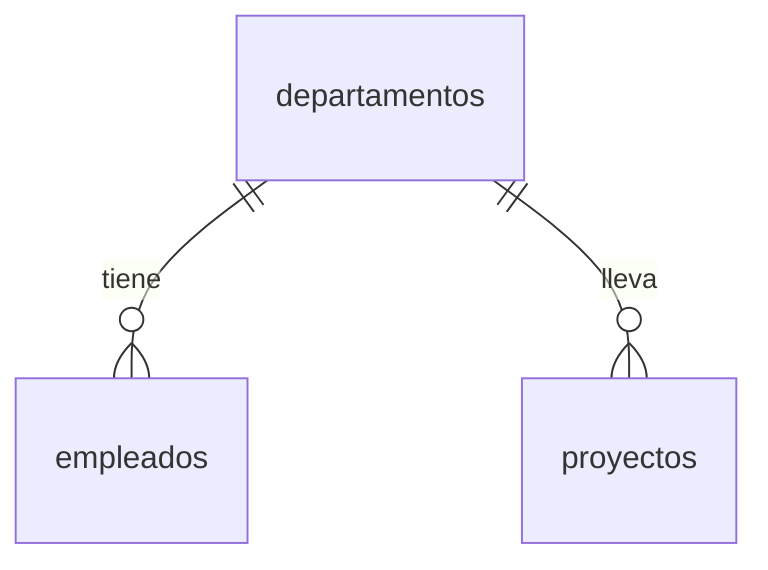

# Clase SQL 3 · Entregable: JOIN y subconsultas con empleados, departamentos y proyectos

Esta clase es la práctica de repaso de [SQL 2](../clase-sql2/README.md), recogida en el script [`Entregable.sql`](Entregable.sql). Se trabaja sobre el modelo `departamentos` / `empleados` / `proyectos` en PostgreSQL (entorno de [clase-docker3](../../docker/clase-docker3/README.md)) y se practica:

1. Crear tablas relacionadas con `REFERENCES`.
2. Cargar datos con valores `NULL` a propósito.
3. Comparar `INNER`, `LEFT`, `RIGHT` y `FULL OUTER JOIN`.
4. Usar **subconsultas** en el `WHERE`.

## Índice

1. [Modelo de datos](#1-modelo-de-datos)
2. [Datos de ejemplo](#2-datos-de-ejemplo)
3. [INNER JOIN](#3-inner-join)
4. [Extra: comparación de JOIN](#4-extra-comparación-de-join)
5. [Subconsultas](#5-subconsultas)
6. [Resumen](#6-resumen)

---

## 1. Modelo de datos



```sql
CREATE TABLE departamentos(
    id      BIGINT GENERATED ALWAYS AS IDENTITY PRIMARY KEY,
    nombre  VARCHAR(100) NOT NULL
);

CREATE TABLE empleados(
    id               BIGINT GENERATED ALWAYS AS IDENTITY PRIMARY KEY,
    nombre           VARCHAR(100) NOT NULL,
    email            VARCHAR(100) NOT NULL,
    salario          NUMERIC(8,2) NOT NULL,
    departamento_id  BIGINT REFERENCES departamentos(id)
);

CREATE TABLE proyectos(
    id               BIGINT GENERATED ALWAYS AS IDENTITY PRIMARY KEY,
    nombre           VARCHAR(100) NOT NULL,
    fecha_inicio     TIMESTAMPTZ NOT NULL DEFAULT CURRENT_TIMESTAMP,
    departamento_id  BIGINT REFERENCES departamentos(id)
);
```

- `departamentos` es la tabla del «uno» y se crea **primero**; `empleados` y `proyectos` (los «muchos») llevan la foreign key `departamento_id`.
- `departamento_id` **no lleva `NOT NULL`** en ninguna de las dos: un empleado puede no tener departamento (Sara). En `proyectos` también queda abierto, así que un proyecto podría quedar sin departamento; si cada proyecto debe pertenecer a uno, bastaría añadir `NOT NULL`.
- La foreign key es `BIGINT`, el mismo tipo que la primary key a la que apunta.
- `salario NUMERIC(8,2)`: decimal exacto, hasta 8 dígitos en total y 2 decimales.
- `fecha_inicio` es `TIMESTAMPTZ` con valor por defecto el instante actual; al insertar `'2026-09-01'` se guarda como las 00:00 de ese día.

## 2. Datos de ejemplo

```sql
INSERT INTO departamentos (nombre) VALUES
('Ventas'), ('Tecnología'), ('Legal'), ('I+D');

INSERT INTO empleados (nombre, email, salario, departamento_id) VALUES
('Ana',   'ana@empresa.com',   52000, 2),
('Luis',  'luis@empresa.com',  38000, 2),
('Marta', 'marta@empresa.com', 45000, 1),
('Pablo', 'pablo@empresa.com', 31000, 1),
('Sara',  'sara@empresa.com',  29000, NULL);   -- Sara no tiene departamento

INSERT INTO proyectos (nombre, fecha_inicio, departamento_id) VALUES
('Web nueva',         '2026-09-01', 2),
('App móvil',         '2026-11-15', 2),
('Campaña de verano', '2027-05-01', 1);        -- Legal e I+D no tienen empleados ni proyectos
```

Los ids se generan solos, por eso los `INSERT` pueden usar `1` = Ventas y `2` = Tecnología.

| Departamento | Empleados | Proyectos |
|---|---|---|
| Ventas (1) | Marta, Pablo | Campaña de verano |
| Tecnología (2) | Ana, Luis | Web nueva, App móvil |
| Legal (3) | — | — |
| I+D (4) | — | — |
| *(sin departamento)* | Sara | — |

## 3. INNER JOIN

Departamento de Sara:

```sql
SELECT departamentos.nombre AS departamento
FROM departamentos
INNER JOIN empleados ON departamentos.id = empleados.departamento_id
WHERE empleados.nombre = 'Sara';
```

Devuelve **0 filas**: Sara tiene `departamento_id = NULL`, no coincide con ningún departamento y el `INNER JOIN` solo devuelve filas con coincidencia. Es la forma de comprobar que no tiene departamento.

Cada empleado con su departamento:

```sql
SELECT empleados.nombre AS empleado, departamentos.nombre AS departamento
FROM departamentos
INNER JOIN empleados ON departamentos.id = empleados.departamento_id;
```

| empleado | departamento |
|---|---|
| Ana | Tecnología |
| Luis | Tecnología |
| Marta | Ventas |
| Pablo | Ventas |

4 filas: **no salen Sara** (sin departamento) **ni Legal e I+D** (sin empleados).

## 4. Extra: comparación de JOIN

Se parte siempre de `FROM departamentos`, así que `departamentos` es la tabla izquierda y `empleados` la derecha.

```sql
-- LEFT JOIN: todos los departamentos
SELECT empleados.nombre AS empleado, departamentos.nombre AS departamento
FROM departamentos
LEFT JOIN empleados ON departamentos.id = empleados.departamento_id;

-- RIGHT JOIN: todos los empleados
SELECT empleados.nombre AS empleado, departamentos.nombre AS departamento
FROM departamentos
RIGHT JOIN empleados ON departamentos.id = empleados.departamento_id;

-- FULL OUTER JOIN: todo de las dos tablas
SELECT empleados.nombre AS empleado, departamentos.nombre AS departamento
FROM departamentos
FULL OUTER JOIN empleados ON departamentos.id = empleados.departamento_id;
```

| JOIN | Filas | Dónde hay `NULL` |
|---|---|---|
| `INNER JOIN` | 4 | En ningún sitio |
| `LEFT JOIN` | 6 | `empleado` en **Legal** e **I+D** |
| `RIGHT JOIN` | 5 | `departamento` de **Sara** |
| `FULL OUTER JOIN` | 7 | `empleado` en Legal e I+D **y** `departamento` de Sara |

Conclusión: el lado que se conserva «entero» depende del `JOIN` y de qué tabla está a cada lado. Con `departamentos` a la izquierda, `LEFT` preserva departamentos y `RIGHT` preserva empleados; el `FULL OUTER JOIN` preserva ambos. Los `NULL` no son errores: indican **qué no tiene pareja**.

## 5. Subconsultas

Una **subconsulta** es un `SELECT` entre paréntesis dentro de otra consulta. Se ejecuta primero y su resultado se usa en el `WHERE` de la externa. Ya se vio en SQL 1 con `MIN(valoracion)`.

### Empleados con salario inferior a la media

```sql
SELECT empleados.nombre AS empleados, empleados.salario AS salario
FROM empleados
WHERE empleados.salario < (
    SELECT AVG(empleados.salario)
    FROM empleados
);
```

La media es 39 000 (195 000 / 5). Salen: **Luis** (38 000), **Pablo** (31 000) y **Sara** (29 000).

### Empleado mejor pagado

```sql
SELECT empleados.nombre AS empleados, empleados.salario AS salario
FROM empleados
WHERE empleados.salario = (
    SELECT MAX(empleados.salario)
    FROM empleados
);
```

Sale **Ana** (52 000). Si varios empleados empatasen en el máximo, saldrían todos.

### Empleados del departamento de Tecnología

```sql
SELECT empleados.nombre AS empleados, departamentos.nombre AS departamento
FROM empleados
INNER JOIN departamentos ON empleados.departamento_id = departamentos.id
WHERE empleados.departamento_id = (
    SELECT departamentos.id
    FROM departamentos
    WHERE departamentos.nombre = 'Tecnología'
);
```

Salen **Ana** y **Luis**. La subconsulta devuelve el `id` de Tecnología (2) y la consulta externa filtra por él.

Notas:

- Con `=`, `<` o `>` la subconsulta debe devolver **un único valor** (una fila y una columna). Si pudiese devolver varios (p. ej. dos departamentos llamados «Tecnología»), daría error; para varios valores se usa `IN`.
- Aquí el `INNER JOIN` solo sirve para mostrar el nombre del departamento; también se podría resolver con `WHERE departamentos.nombre = 'Tecnología'` sin subconsulta.

## 6. Resumen

| Concepto | Para qué |
|---|---|
| `REFERENCES tabla(id)` | Declarar la foreign key y garantizar que el valor existe |
| FK sin `NOT NULL` | Permite filas sin relación (Sara sin departamento) |
| `INNER JOIN` | Solo filas con coincidencia |
| `LEFT` / `RIGHT` / `FULL OUTER JOIN` | Conservar todas las filas de la izquierda / derecha / ambas, con `NULL` donde no hay pareja |
| `WHERE col < (SELECT AVG(...))` | Filtrar por un valor calculado con otra consulta |
| `WHERE col = (SELECT MAX(...))` | Quedarse con la fila del máximo |
| `WHERE col = (SELECT id FROM ... WHERE ...)` | Buscar un id por nombre sin conocerlo de antemano |
